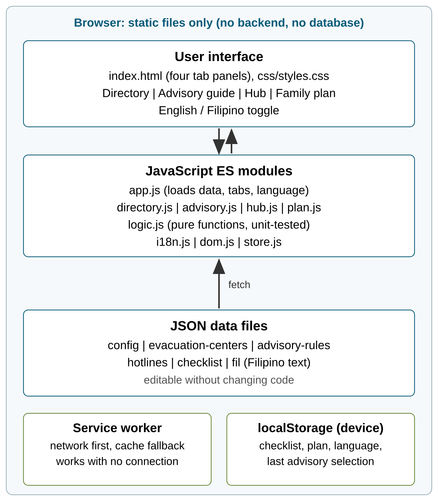
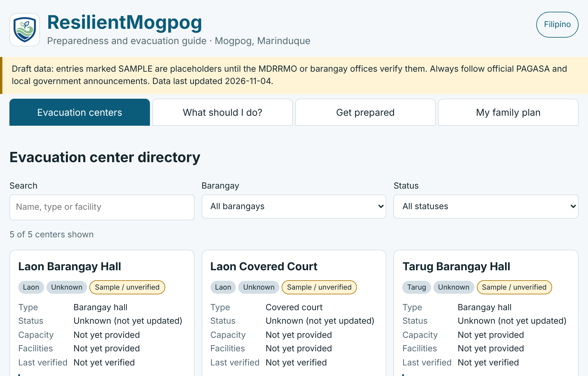
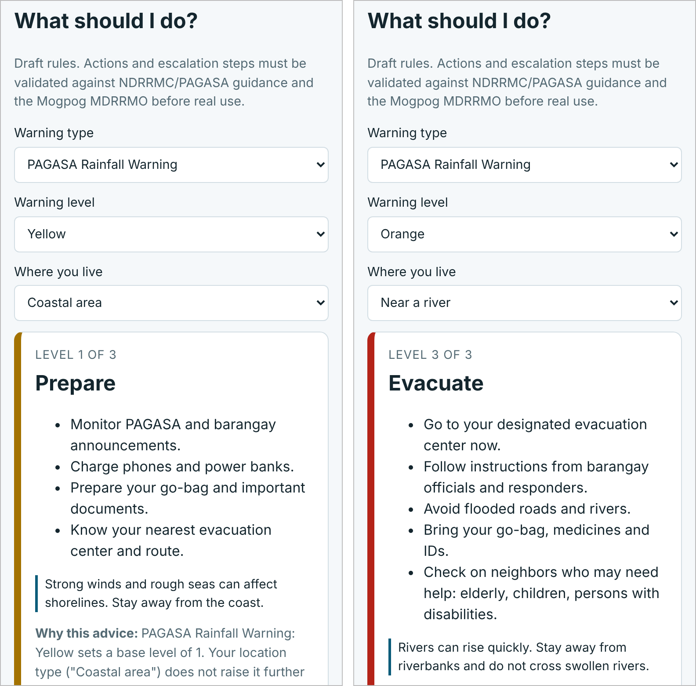
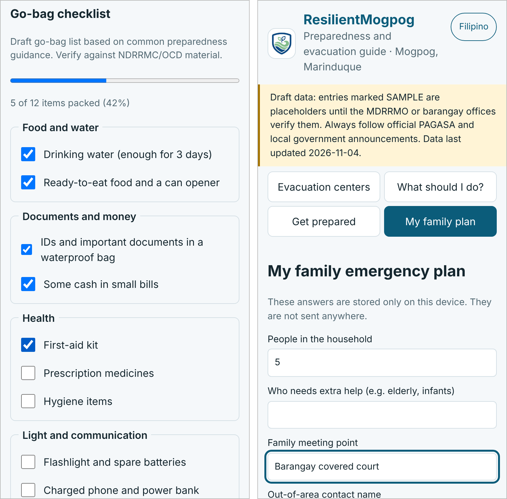

# ResilientMogpog: An Offline-Capable Web Portal for Evacuation Information and Rule-Based Preparedness Advice in Mogpog, Marinduque

Eric Jae Maaño, Dyan Krisna Paz, Roderick Parreño, Mel Joy Mendeja, Ruth Ann Rocha, Maria Amanda Son
Group "Never Grow Old," BSIT 3C, College of Information and Computing Sciences, Marinduque State University, Boac, Marinduque, Philippines
Web Systems and Technologies 1 · November 13, 2026

*This Markdown file contains the same content as the formatted manuscript in `docs/final-manuscript.pdf`.*

**Abstract**—Mogpog, Marinduque is regularly affected by typhoons and flooding; during Typhoon Kristine in October 2024, forced evacuations were carried out in 20 of its 37 barangays. During such events, residents must find which evacuation centers to go to and decide when to leave, but the information is often scattered across social media posts and announcements, and can be hard to reach when power or internet fails. This paper presents ResilientMogpog, a frontend-only, offline-capable web portal with four implemented features: an evacuation center directory, a rule-based advisory guide that links PAGASA rainfall warnings and wind signals to recommended actions according to where a household lives, a go-bag checklist with preparedness guides and hotlines, and a printable family emergency plan. The system uses HTML5, CSS3, and vanilla JavaScript, keeps all place-specific content in JSON files so it can be adapted to other areas, and uses a service worker for offline access. Its core logic passed 17 automated unit tests, and browser tests on phone-sized screens in English and Filipino found no failures after defects found during development were fixed. The evacuation center data and advisory rules are draft entries pending validation by the Mogpog MDRRMO, the system has not been evaluated with end users, and role-based publishing for officials remains unimplemented. The portal shows how a low-cost, data-driven tool can support local preparedness, and future work centers on validated local data and usability testing with residents and officials.

*Index Terms*—disaster risk reduction, evacuation information, early warning, offline web application, Mogpog

---

# I. INTRODUCTION

## A. Background of the Study

The Philippines is exposed to repeated typhoon impacts, and Marinduque is no exception. When Typhoon Kristine approached in October 2024, the Mogpog municipal disaster risk reduction and management officer reported forced evacuations in 20 of Mogpog's 37 barangays because of flooding and landslide threats, with evacuees sheltering in barangay halls and covered courts; floodwater in Barangay Laon was knee-deep, and a road shoulder collapse and fallen tree blocked a road in Barangay Tarug [1]. In November 2025, Marinduque was again placed under Tropical Cyclone Wind Signal No. 3 and on red alert as Typhoon Uwan struck, during a national preemptive evacuation of more than 1.17 million people [2]. Flooding in Mogpog also carries a local legacy risk: studies of the Boac and Mogpog rivers link flooding to contamination of floodplain soils with manganese from abandoned mine pits and tailings storage facility failures in the 1990s [3].

National policy treats this preparedness work as a shared responsibility. Republic Act No. 10121 strengthens the Philippine disaster risk reduction and management (DRRM) system and institutionalizes the National DRRM Plan [4]. The 2020–2030 plan gives strategic direction to national agencies and local governments, and calls for convergence of DRRM and climate change adaptation [5]. Globally, the Sendai Framework includes a target to make multi-hazard early warning systems more available and accessible by 2030 [6].

## B. Problem Statement

Having warnings and plans does not guarantee that residents can act on them. A case study of flood information in Bacolor, Pampanga found that residents were poorly informed about flood risks, attributing this to limited funding for information dissemination and a top-down warning system, and recommended low-cost, low-technology communication methods [7]. In last-mile communities in northern Philippines, remoteness and weak power and internet infrastructure limited how quickly warnings arrived, and trust in local authorities and social networks influenced whether people prepared [8]. Industry analysis of digital early warning in the Philippines similarly stresses that systems must work reliably, stay cost-effective, and reach remote and marginalized groups [9]. Evidence on evacuation behavior shows why the details matter: in a survey of 1,055 residents after the 2017 Surigao City earthquake, receiving a warning was among the factors associated with leaving home, and most evacuees moved to nearby open spaces or public shelters, usually on foot [10]; after Typhoon Haiyan in Eastern Samar, household characteristics influenced whether families chose public shelters or relatives' homes [11].

Taken together, the sources suggest a gap at the household level: official information exists but is not packaged in a form that a resident, possibly offline and under time pressure, can quickly turn into a decision. For Mogpog, the group could not find a single place where a resident can look up designated evacuation centers, see what a given warning level means for their own location, and prepare in advance. This paper treats that as the problem to address. The group did not conduct interviews or surveys; the problem statement therefore rests on the published sources and incident reports cited here, and should be validated locally (Section IV).

## C. Project Objectives

The general objective is to develop a frontend-only, offline-capable web portal that helps Mogpog residents find evacuation information, understand what a warning means for their situation, and prepare their households. The specific objectives are to: (1) provide a searchable directory of evacuation centers that shows each entry's verification status; (2) translate a PAGASA warning level and the resident's location type into an action level with an explanation; (3) provide preparedness content that remains usable without a connection; (4) let households record a personal emergency plan on their own device; and (5) verify the implemented features with repeatable tests and report limitations openly. A further objective, role-based management of information by authorized staff, was planned but not implemented (Section III-E).

## D. Proposed Solution and Contribution

ResilientMogpog is a static website, with no server or database, that works as a preparedness and evacuation information portal. Its contribution relative to separate announcements is to place four household-level tools in one offline-capable page: where to go, what to do for a given warning and location, what to prepare, and a personal plan. All content that depends on place, such as centers, hotlines, and rules, is stored in JSON files, so the same code can serve another barangay or municipality by replacing data. The solution does not generate warnings; it interprets official PAGASA categories entered by the user.

## E. Scope and Limitations

The intended users are residents of Mogpog, and secondarily barangay officials who maintain the data files. Supported functionality is limited to the four features described in Section III. The portal does not read live PAGASA data, does not track shelter occupancy in real time, and does not provide maps or routing. The evacuation center entries, hotline numbers, and advisory rules in the submitted version are draft placeholders pending verification by the MDRRMO and barangay offices, and are labeled as such in the interface.

# II. METHODOLOGY

## A. Development Approach

The group used an iterative, prototype-driven approach. A concept was selected in Week 1 and refined into requirements from the literature and incident reports in Section I. A minimum viable product with three features was built and documented in Week 2; in the final phase the group lead added the family plan, center status fields, map-search links, a Filipino interface, and responsive-layout fixes, and corrected defects found during review. Requirements analysis was desk-based. No interviews, surveys, or field observation were conducted. Code was developed with the assistance of a generative AI tool under the group lead's direction, as disclosed in the AI Disclosure section and the repository file *AI_DISCLOSURE.md*; outputs were reviewed, run, and tested by the group lead.

## B. Requirements and Core Features

Table I links each identified need to a feature and an acceptance criterion that can be checked by observation.

**TABLE I.** Requirements and core features

| Need (source) | Feature | Acceptance criterion |
|:--------------|:--------|:---------------------|
| Residents need to know where to go and what each center offers [1], [10], [11] | F1 Evacuation center directory | Search and barangay or status filters return matching centers; unverified entries are flagged |
| Warnings must become actions that depend on location [7]–[10] | F2 Advisory guide | A warning plus location type gives an action level 0–3, steps, and a reason; higher exposure can raise the level, capped at 3 |
| Preparation must work when connectivity fails [8], [9], [12] | F3 Preparedness hub | Checklist progress persists after reload; hotlines are listed; the portal reopens offline |
| Household characteristics shape evacuation choices [11] | F4 Family plan | Entries persist on the device and the plan can be printed |
| Officials must keep information current [4], [5] | F5 Role-based management | Planned; not implemented |

## C. System Architecture and Design

Fig. 1 shows the structure. The interface is a single HTML page with four tab panels. JavaScript ES modules load JSON data at start-up, render each panel, and keep decision logic (filtering, advisory severity, progress counts) in pure functions in *logic.js* so they can be tested without a browser. A service worker caches the application shell and data. User-entered state (checklist, plan, language, last advisory selection) is stored in the browser's localStorage under a "resilient." prefix, wrapped in error handling so that the page still works if storage is blocked.

The advisory guide uses a rule table rather than a formula hidden in code. Each warning level has a base level, and a location type can add one level for certain warnings, capped at three (Table II). Wind signal definitions follow PAGASA's published categories, which pair each signal with an expected wind speed range and lead time (for example, Signal No. 3 for 89–117 km/h winds, expected within 18 hours) [13]. The mapping from warning to action level is the group's draft design and is not an official product.

**TABLE II.** Advisory rule model (draft)

| Warning input | Base level | Location rule |
|:--------------|:----------:|:--------------|
| Rainfall: Yellow / Orange / Red | 1 / 2 / 3 | +1 near a river, low-lying, or upland |
| Wind: Signal 1–2 | 1 | +1 for coastal |
| Wind: Signal 3 | 2 | +1 for coastal |
| Wind: Signal 4–5 | 3 | +1 for coastal (capped at 3) |
| No warning | 0 | none; shows "Stay informed" |

## D. Technology Selection and Comparative Justification

Table III summarizes the technology choices. The decisions follow the project's scope: a frontend-only site with limited interaction (four panels and a few forms) that must run on inexpensive phones and low connectivity. Where no source is cited, the reasoning is the group's own and is not claimed as literature-supported.

**TABLE III.** Technology selection

| Technology | Alternative | Why chosen for this project | Evidence |
|:-----------|:------------|:----------------------------|:---------|
| HTML5, CSS3 (grid, media queries) | CSS framework | Responsive layout with no dependencies; tested at 320–390 px | Group reasoning; accessibility goals follow [14] |
| Vanilla JavaScript (ES modules) | React | Few interactions; no build step; easy for others to read and edit | Group reasoning |
| JSON data files | Server database | Content edited without code; works on static hosting; low-cost, low-technology approach | [7], [9] |
| Service worker | Online-only page | Offline reopening when power or internet fails | [8], [15]; no significant energy impact measured in [16] |
| localStorage | Accounts and server storage | Keeps household data on the device; persists after the browser closes | [17] |
| Node test runner, Playwright | Manual checks only | Repeatable logic and browser checks | Group practice |

## E. Development and Implementation

The directory filters an array of center records by text and barangay, and by a status field (open, full, closed, or unknown) with an update date. Each card shows type, status, capacity, facilities, last-verified date, and a route note, with a "Sample / unverified" tag when a record is not yet verified. Two links open a Google Maps search, one for the center's name and barangay and one for the barangay area as a fallback; the portal does not store coordinates. The advisory guide reads the rule file and returns, for each choice, the action level, its steps, any location note, and an explanation sentence. The hub renders a twelve-item go-bag checklist adapted from public preparedness guidance such as [12], with progress saved locally, before/during/after guides, and four hotline entries. The family plan stores eight fields (household size, who needs help, meeting point, out-of-area contact name and number, chosen center, pet or livestock plan, and document location) and uses the browser's print function. A language toggle switches between English and Filipino text, which is loaded from a separate JSON file. All user data stays on the device.

## F. Evaluation Procedure

The following checks were actually performed by the group lead with AI-assisted tooling, in November 2026:

1. **Unit tests.** Seventeen tests in *tests/logic.test.mjs*, run with the Node.js test runner, cover center search and filters, status filtering, advisory severity, escalation and the cap, invalid input, checklist and plan progress, map-link construction, and completeness of the Filipino data file against the English data.
2. **Scripted browser tests.** A Playwright script in headless Chromium at a 390 × 800 viewport exercised each feature in English and Filipino: filtering, a no-match search, advisory selections, checklist and plan persistence across reload, language persistence, and reload with the network switched off.
3. **Text-integrity scan.** The script scanned all four panels in both languages for the strings "[object", "undefined", and "NaN".
4. **Layout checks.** Viewports of 390, 360, and 320 px were checked for horizontal overflow, clipped tab labels, and visible controls shorter than 40 px.

Not performed: usability testing with residents or officials, validation of data or rules with the MDRRMO, screen-reader or full keyboard-navigation audits, automated accessibility audits, testing on physical phones, Safari or Firefox, and performance testing. Findings from these checks are limited accordingly.

# III. RESULTS AND DISCUSSION

## A. Core Feature 1: Evacuation Center Directory

*Purpose and requirement.* Residents need to see which centers exist and what each offers (Table I, F1). *Behavior.* The directory lists five records: four placeholder centers in Barangays Laon and Tarug, named because those barangays were affected during Typhoon Kristine [1], and one sample record that shows how capacity and facilities appear once filled in (Fig. 2). *Observed result.* Filtering by Tarug returned its two centers; filtering by status "open" returned the one sample record that carries that status; a search with no match displayed the message "No evacuation centers match your search"; and the "Find on map" links were generated. The first version of these links used an OpenStreetMap search, which returned no result for the placeholder names when the group tried it, so the links now use Google Maps with a second link for the barangay area. The link addresses were checked by test, but the group did not verify what Google Maps returns for each placeholder name. *Interpretation and limitation.* The behavior is correct, but the content is not yet useful to real residents: no record has been verified, capacities and facilities are empty, and route information is limited to notes. Whether the center types match reality is supported only by the news report that evacuees used barangay halls and covered courts [1].

## B. Core Feature 2: Advisory Guide

*Purpose and requirement.* The guide turns an official category into an action that depends on location (Table I, F2), responding to the gap between warnings and action discussed in [7]–[10]. *Behavior.* The user selects a PAGASA rainfall warning or wind signal and a location type. The result shows an action level, steps, a location note, and a "why this advice" line (Fig. 3). *Observed result.* Yellow rainfall on the coast produced Level 1 "Prepare"; Orange rainfall near a river was raised from base 2 to Level 3 "Evacuate", with the explanation stating the reason; no warning produced Level 0 "Stay informed"; and wind Signal 4 on the coast returned Level 3, the cap. The same Orange-near-river case was reproduced in Filipino. *Interpretation and limitation.* The logic works as designed, and showing the reason supports trust, a factor identified in [8]. However, the rules are the group's own interpretation, unvalidated by the MDRRMO, and the user must enter the warning manually, so the guide cannot replace official announcements.

## C. Core Feature 3: Preparedness Hub

*Purpose and requirement.* Preparation must remain possible when connectivity is weak (Table I, F3). *Behavior.* The hub combines a twelve-item go-bag checklist with a progress bar, before/during/after guides, and hotlines (Fig. 4a). *Observed result.* Ticking items updated the progress count (for example, "5 of 12 items packed (42%)" in Fig. 4a); two ticked items were still ticked, with the count "2 of 12 items packed (17%)", after a page reload; and with the network switched off after a first visit, the portal reloaded and kept its content. *Interpretation and limitation.* This addresses the connectivity concern raised in [8] and [9] for devices that have visited the page once; a first visit still requires a connection. Only the 911 hotline is filled in. Mogpog MDRRMO, barangay, and provincial numbers are shown as "Number pending", which is accurate but means the hotline list is not yet useful locally.

## D. Core Feature 4: Family Emergency Plan

*Purpose and requirement.* Household characteristics shape evacuation decisions [11], so the plan lets each household record its own choices (Table I, F4). *Behavior.* Eight fields are saved as the user types, with a "fields filled" counter and a print button (Fig. 4b). A privacy note states that answers stay on the device. *Observed result.* With three fields entered (household size, meeting point, chosen center) the counter showed "3 of 8 fields filled", and the meeting point and chosen center were still present after a reload. *Interpretation and limitation.* Because data is stored only in one browser, a plan does not follow a user to another device, and clearing browser data deletes it. Printing was provided but its output was not tested on a physical printer.

## E. Planned Feature 5: Role-Based Information Management

Role-based publishing by authorized staff is not implemented. It requires authenticated access and a server or approved managed service, which falls outside the frontend-only scope of this project. As an interim approach, authorized staff would edit the JSON data files in the repository. This means that currently there is no access control and no way for officials to update data without editing files, which is a significant limitation for keeping status information current.

## F. Consolidated Evaluation

Table IV summarizes the observed results against the acceptance criteria in Table I.

**TABLE IV.** Functional verification

| Feature | Expected behavior | Observed evidence | Status |
|:--------|:------------------|:------------------|:------:|
| F1 Directory | Search and filters return matches; flags unverified entries | Tarug filter: 2 centers; "open": 1; no-match message; 4 map links | Pass (sample data) |
| F2 Advisory | Level 0–3 with steps and reason; location can raise level; cap at 3 | Orange + river gave Level 3 with reason; Yellow + coast gave Level 1; Signal 4 + coast capped at 3; 17/17 unit tests | Pass (rules unvalidated) |
| F3 Hub | Progress persists; hotlines listed; opens offline | 2/12 ticked items persisted after reload; offline reload succeeded; only 911 filled | Partial (data pending) |
| F4 Family plan | Entries persist; printable | Counter 3 of 8; meeting point and center persisted after reload; print not tested on a printer | Pass |
| Bilingual UI | Text switches and persists | Filipino shown after toggle and reload; no placeholder text found in 4 panels, 2 languages | Pass (translation unreviewed) |
| F5 Role-based | Staff can update records | Not implemented | Not met |

## G. Defects Found During Development

Testing and review revealed defects that the first test version did not catch, and they are reported here for transparency. (1) Evacuation center cards displayed the text "[object HTMLElement]" instead of details, because a nested list of elements was not flattened; it was found by the group lead on a screenshot after delivery of an earlier build. (2) The advisory panel showed the word "null" when no location note applied, because a null value was passed to the browser's append function. (3) At 360 px, tab labels were clipped and the title wrapped mid-word; the tabs were changed to a two-column grid and the title size reduced. All three were fixed, and the text-integrity scan and layout checks were added to the test procedure afterward. These defects show that the early test set tested logic but not rendered output, and that interface review on real screens remains necessary.

## H. Discussion

The portal's design follows several findings in the literature. Using static JSON data, local storage, and a service worker keeps cost and technical demands low, consistent with the recommendation for low-cost, low-technology communication [7] and the emphasis on cost-effectiveness and reliability [9]. Offline operation responds to the infrastructure limits reported in [8]; reported measurements also suggest that adding a service worker did not significantly change device energy use in their test setup [16], although this was not measured here. Making the reason for each recommendation visible is intended to support trust, which [8] found to influence preparedness. The household plan reflects evidence that evacuation choices depend on household and situational factors [10], [11].

The results should not be read as evidence that the portal improves preparedness or evacuation outcomes. No such outcome was measured. What was shown is narrower: the four features behave as specified under the tests described in Section II-F, using placeholder data. The portal's real value depends on the local data and rules that the MDRRMO and barangay offices can supply and verify, and on whether residents find it usable, neither of which has been established.

# IV. CONCLUSION

The project produced a working, frontend-only portal with four implemented features: an evacuation center directory, a rule-based advisory guide, an offline preparedness hub, and a family emergency plan, with an English and Filipino interface and offline reopening. Four of the five specific objectives were met at the level of verified behavior; the objective of role-based management was not. Its practical relevance lies in a low-cost, adaptable pattern for packaging local preparedness information at the household level.

The main limitations are that all center records, hotline numbers, and advisory rules are draft data awaiting validation, the user must enter warnings manually, routes are text notes, the Filipino translation has not been reviewed by a language professional, no residents or officials have tested the portal, and accessibility has not been audited with assistive technology. Recommended next steps are: (1) obtain and verify real center, capacity, and hotline data from the Mogpog MDRRMO and barangays and remove the sample flags; (2) validate the advisory rules against NDRRMC and PAGASA guidance; (3) run a usability study with residents and officials; (4) perform an accessibility audit against WCAG 2.2 [14]; (5) add map or route images per center; and (6) design a role-based update process that fits an approved hosting arrangement.

# AI DISCLOSURE

Generative AI (Claude, Anthropic) was used to scaffold and revise the application code, write the unit and browser tests, draft the Filipino interface text, prepare figures and screenshots, and draft this manuscript from the group's project materials. The group lead directed the work, ran the code and tests, and reviewed the outputs. Reference details were checked against the cited web pages. Prompts, outputs used, and validation methods are recorded in *AI_DISCLOSURE.md* in the repository.

# CRediT AUTHOR CONTRIBUTIONS STATEMENT

E. J. Maaño: Conceptualization, Software, Validation, Writing—original draft. D. K. Paz, R. Parreño, M. J. Mendeja, R. A. Rocha, and M. A. Son: [roles to be confirmed by the group before submission, per *CONTRIBUTIONS.md*].

# AVAILABILITY

Source code: https://github.com/SethSyzygy/resilient-mogpog. Live application (GitHub Pages): https://sethsyzygy.github.io/resilient-mogpog/.

# REFERENCES

[1] A. Sapit, "Typhoon Kristine forces evacuation of over 300 families in Mogpog," *Romblon News Network*, Oct. 23, 2024. [Online]. Available: https://romblonnews.net/2024/10/typhoon-kristine-forces-evacuation-of-over-300-families-in-mogpog/

[2] P. Lee-Brago, "Over 1 million flee Uwan's fury," *The Philippine Star*, Nov. 10, 2025. [Online]. Available: https://www.philstar.com/headlines/2025/11/10/2486080/over-1-million-flee-uwans-fury

[3] C. E. F. Monjardin, D. B. Senoro, J. J. M. Magbanlac, K. L. M. de Jesus, C. B. Tabelin, and P. M. Natal, "Geo-accumulation index of manganese in soils due to flooding in Boac and Mogpog rivers, Marinduque, Philippines with mining disaster exposure," *Appl. Sci.*, vol. 12, no. 7, Art. no. 3527, Mar. 2022, doi: 10.3390/app12073527.

[4] Republic of the Philippines, "Republic Act No. 10121: An Act Strengthening the Philippine Disaster Risk Reduction and Management System, Providing for the National Disaster Risk Reduction and Management Framework and Institutionalizing the National Disaster Risk Reduction and Management Plan, Appropriating Funds Therefor and for Other Purposes," May 27, 2010. [Online]. Available: https://issuances-library.senate.gov.ph/legislative-issuance/republic-act-no-10121

[5] "Philippines: National disaster risk reduction and management plan 2020–2030," PreventionWeb. [Online]. Available: https://preventionweb.net/quick/82402

[6] United Nations, "Sendai Framework for Disaster Risk Reduction 2015–2030," adopted Mar. 18, 2015, Sendai, Japan. [Online]. Available: https://www.preventionweb.net/fr/node/100504

[7] N. Espina Jr., R. Daggy, J. Genova, D. Lo, and N. Soputhy, "Community based information dissemination and communication strategies for flood disaster planning in the Philippines: A case study of Bacolor, Pampanga," *J. Int. Dev. Coop.*, vol. 19, no. 3, pp. 155–164, 2013, doi: 10.15027/35047.

[8] R. Yanquiling, "Factors influencing accessibility and actionability of risk reduction measures in last mile communities: Insights from the northern Philippines," Global Disaster Preparedness Center, Sep. 2024. [Online]. Available: https://preparecenter.org/resource/factors-influencing-accessibility-and-actionability-of-risk-reduction-measures-in-last-mile-communities-insights-from-the-northern-philippines/

[9] GSMA, "Strengthening disaster preparedness in the Philippines through digital innovation," GSMA Mobile for Development, n.d. [Online]. Available: https://www.gsma.com/solutions-and-impact/connectivity-for-good/mobile-for-development/blog/strengthening-disaster-preparedness-in-the-philippines-through-digital-innovation/

[10] S. R. Calumba, M. Rith, and A. M. Fillone, "Earthquake evacuation choice and management in a developing archipelagic country—A case study of Surigao City, Philippines," *Sustainability*, vol. 13, no. 11, Art. no. 5783, May 2021, doi: 10.3390/su13115783.

[11] M. B. B. Lim, H. R. Lim, and J. M. L. Anabo, "Evacuation destination choice behavior of households in Eastern Samar, Philippines during the 2013 Typhoon Haiyan," *Int. J. Disaster Risk Reduct.*, vol. 56, Art. no. 102137, 2021, doi: 10.1016/j.ijdrr.2021.102137.

[12] UNICEF Philippines, "Emergency Go-Bag checklist." [Online]. Available: https://www.unicef.org/philippines/emergency-go-bag-checklist

[13] PAGASA, "Tropical Cyclone Wind Signal," PAGASA Learning Tools. [Online]. Available: https://pagasa.dost.gov.ph/learning-tools/tropical-cyclone-wind-signal

[14] World Wide Web Consortium (W3C), "Web Content Accessibility Guidelines (WCAG) 2.2," W3C Recommendation, Oct. 5, 2023. [Online]. Available: https://www.w3.org/TR/WCAG22/

[15] Mozilla, "Service Worker API," MDN Web Docs. [Online]. Available: https://developer.mozilla.org/en-US/docs/Web/API/ServiceWorker_API

[16] I. Malavolta, G. Procaccianti, P. Noorland, and P. Vukmirovic, "Assessing the impact of service workers on the energy efficiency of progressive web apps," in *Proc. 4th IEEE/ACM Int. Conf. Mobile Softw. Eng. Syst. (MOBILESoft)*, 2017, pp. 35–45, doi: 10.1109/MOBILESoft.2017.7.

[17] Mozilla, "Client-side storage," MDN Web Docs. [Online]. Available: https://developer.mozilla.org/en-US/docs/Learn/JavaScript/Client-side_web_APIs/Client-side_storage
