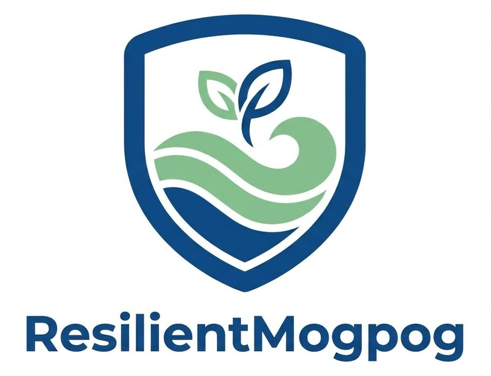

# ResilientMogpog



**An offline-capable web portal for evacuation information and rule-based preparedness advice in Mogpog, Marinduque.**
Web Systems and Technologies 1 final project, group "Never Grow Old", BSIT 3C, Marinduque State University.

- **Live project:** https://sethsyzygy.github.io/resilient-mogpog/
- **Repository:** https://github.com/SethSyzygy/resilient-mogpog

## Selected sector
Disaster Risk Reduction and Climate Change Adaptation (DRR/CCA).

## Problem
Mogpog is exposed to typhoons, flooding and landslides (Typhoon Kristine, October 2024, hit Laon and Tarug hard). Residents need to know where to evacuate, what to do at a given warning level, and what to prepare, often when signal and power are poor. Literature on Philippine disasters points to gaps in preparedness and in access to usable information. We did not survey local residents; see the manuscript for the full problem statement and its limits.

## Proposed solution
A static, frontend-only web app that works offline after the first load. Place-specific content lives in JSON files, so it can be corrected by the MDRRMO or barangay staff without code changes.

## Core features (Week 2 MVP)
1. **Evacuation center directory**: search and filter by barangay, with capacity, facilities, route notes and verification date.
2. **"What should I do?" advisory guide**: pick a PAGASA rainfall warning or wind signal plus your location type. A rule table returns an action level and a plain-language "why" line.
3. **Preparedness hub**: go-bag checklist (progress saved in localStorage), before/during/after guides, hotlines.
4. **My family plan**: household emergency plan (meeting point, contact, chosen center, documents) saved only on the device and printable.

Also: center status (open/full/closed/unknown, with update date), "Find on map" search links, and an English/Filipino toggle (the Filipino text is a draft translation and needs a native-speaker check).

Works offline after the first load (service worker).

## Technologies used
HTML5, CSS3, vanilla JavaScript (ES modules), JSON data files, localStorage, service worker. No backend or database.

## Running instructions
ES modules and fetch need a server (not `file://`):
```
python3 -m http.server 8000
```
Open http://localhost:8000. Run tests with `node --test tests/logic.test.mjs` (Node 18+).

## Publish on GitHub Pages
1. Push this folder to a GitHub repository (files at the repo root).
2. Repo Settings > Pages > Source: "Deploy from a branch" > branch `main`, folder `/ (root)` > Save.
3. After a minute the site is live at `https://<username>.github.io/<repo>/`. Paths are relative, so no changes are needed.

## Adapting to another area
All place-specific content lives in `data/*.json`. Change `config.json`, the centers, hotlines and checklist to retarget the portal to another municipality or scope. No code changes needed.

## Data status (important)
- Evacuation centers, rules and hotlines are **draft/sample**, flagged in the UI, until verified with the Mogpog MDRRMO and barangay offices.
- Laon and Tarug are named because they were affected during Typhoon Kristine (Oct 2024); the center names themselves are placeholders.
- Only 911 is filled in; other numbers are marked pending.
- Advisory rules are a simplified model, not an official PAGASA/NDRRMC product.

## Group members
Eric Jae Maaño (group lead), Dyan Krisna Paz, Roderick Parreño, Mel Joy Mendeja, Ruth Ann Rocha, Maria Amanda Son. Roles: see [CONTRIBUTIONS.md](CONTRIBUTIONS.md).

## Documentation and disclosure
- Full documentation (manuscript, Markdown): [PROJECT_DOCUMENTATION.md](PROJECT_DOCUMENTATION.md)
- Manuscript PDF: [docs/final-manuscript.pdf](docs/final-manuscript.pdf)
- AI use disclosure: [AI_DISCLOSURE.md](AI_DISCLOSURE.md)

## Structure
```
index.html  sw.js  css/styles.css
js/  app.js dom.js store.js i18n.js logic.js directory.js advisory.js hub.js plan.js
data/  config evacuation-centers advisory-rules hotlines checklist fil (.json)
tests/logic.test.mjs
assets/  logo and icons
AI_DISCLOSURE.md  CONTRIBUTIONS.md  PROJECT_DOCUMENTATION.md
docs/  final-manuscript.pdf  figures/
```
