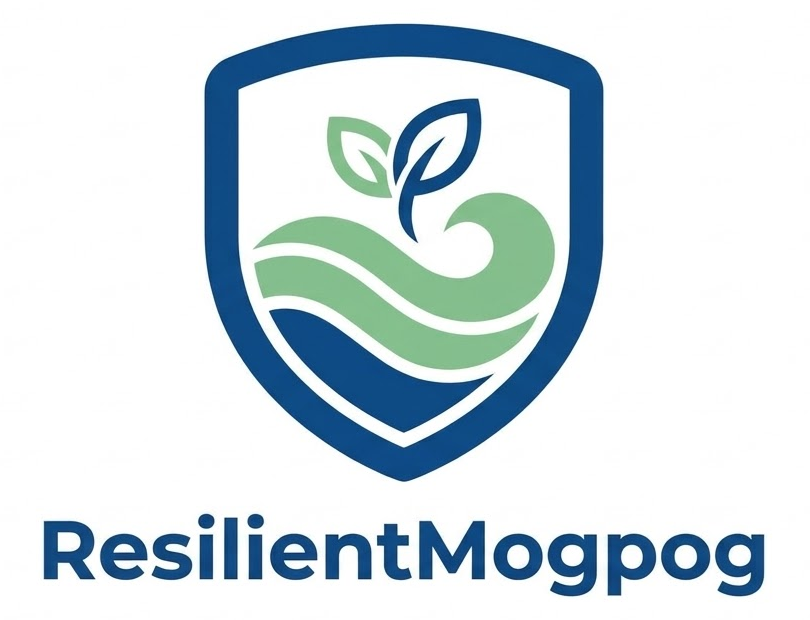

# ResilientMogpog



Frontend-only preparedness and evacuation information portal for Mogpog, Marinduque.
Web Systems and Technologies 1 final project, group "Never Grow Old", BSIT 3C, MarSU.

## Core features (Week 2 MVP)
1. **Evacuation center directory**: search and filter by barangay, with capacity, facilities, route notes and verification date.
2. **"What should I do?" advisory guide**: pick a PAGASA rainfall warning or wind signal plus your location type. A rule table returns an action level and a plain-language "why" line.
3. **Preparedness hub**: go-bag checklist (progress saved in localStorage), before/during/after guides, hotlines.
4. **My family plan**: household emergency plan (meeting point, contact, chosen center, documents) saved only on the device and printable.

Also: center status (open/full/closed/unknown, with update date), "Find on map" search links, and an English/Filipino toggle (the Filipino text is a draft translation and needs a native-speaker check).

Works offline after the first load (service worker).

## Stack
HTML5, CSS3, vanilla JavaScript (ES modules), JSON data files, localStorage, service worker. No backend or database.

## Run
ES modules and fetch need a server (not `file://`):
```
python3 -m http.server 8000
```
Open http://localhost:8000. Run tests with `node --test tests/logic.test.mjs` (Node 18+).

## Publish on GitHub Pages
1. Push this folder to a GitHub repository (files at the repo root).
2. Repo Settings > Pages > Source: "Deploy from a branch" > branch `main`, folder `/ (root)` > Save.
3. After a minute the site is live at `https://<username>.github.io/<repo>/`. Paths are relative, so no changes are needed.

## Adapting to another area
All place-specific content lives in `data/*.json`. Change `config.json`, the centers, hotlines and checklist to retarget the portal to another municipality or scope. No code changes needed.

## Data status (important)
- Evacuation centers, rules and hotlines are **draft/sample**, flagged in the UI, until verified with the Mogpog MDRRMO and barangay offices.
- Laon and Tarug are named because they were affected during Typhoon Kristine (Oct 2024); the center names themselves are placeholders.
- Only 911 is filled in; other numbers are marked pending.
- Advisory rules are a simplified model, not an official PAGASA/NDRRMC product.

## Structure
```
index.html  sw.js  css/styles.css
js/  app.js dom.js store.js i18n.js logic.js directory.js advisory.js hub.js plan.js
data/  config evacuation-centers advisory-rules hotlines checklist fil (.json)
tests/logic.test.mjs
assets/  logo and icons
AI_DISCLOSURE.md
```
